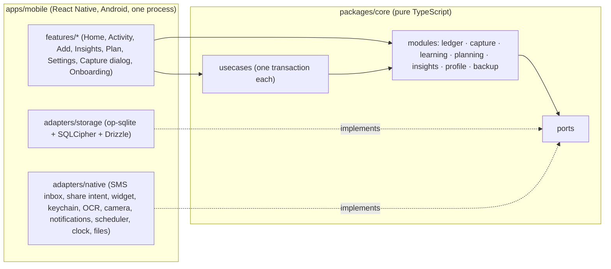
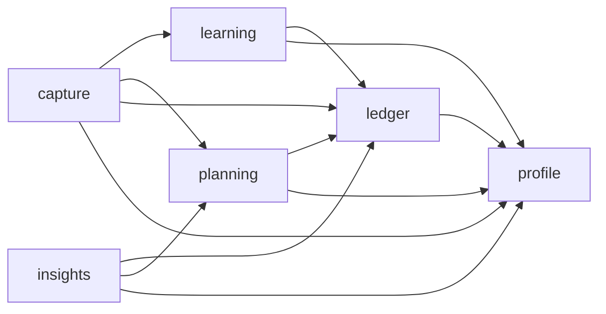
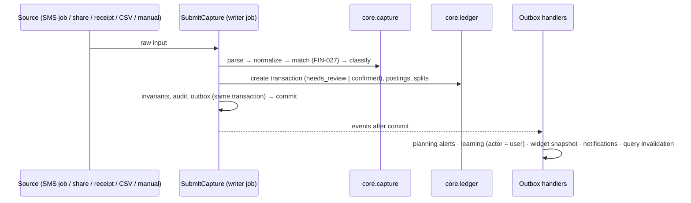
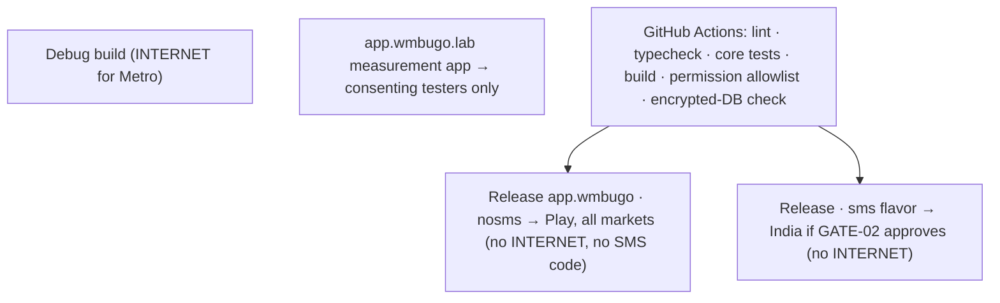

# Architecture Spine — wmbugo app

## Design Paradigm

**Hexagonal core, feature UI.** All business rules live in a pure TypeScript core behind ports; everything platform-specific is an adapter; the UI is organised by feature and talks only to the core's use cases and queries. Inside the core, modules own their data, a use-case layer coordinates them in one transaction, and capture is a fixed pipes-and-filters chain.



## Invariants & Rules

### AD-1 — Hexagonal core, feature UI [ADOPTED]

- **Binds:** all
- **Prevents:** business rules spread across screens and adapters; React Native, Android or SQL details inside domain logic.
- **Rule:** Every financial rule, calculation, validation and decision lives in `packages/core`. Adapters only translate between ports and the platform. UI features call core use cases and queries only; they never compute balances, totals, eligibility or periods.

### AD-2 — Workspace boundary enforced by the compiler [ADOPTED]

- **Binds:** all, NFR-13
- **Prevents:** platform imports leaking into the core.
- **Rule:** pnpm workspace with `packages/core` and `apps/mobile`. `packages/core` declares no dependency on `react-native`, any React Native library, Drizzle or op-sqlite; it compiles and tests in plain Node. `apps/mobile` depends on `core`, never the reverse.

### AD-3 — Module ownership and dependency direction [ADOPTED]

- **Binds:** FIN-*, CAP-*, LRN-*, BDG-*, REC-*, GOAL-*, INS-*, SET-*, BKP-*
- **Prevents:** two modules writing the same table in different ways; hidden cross-module coupling.
- **Rule:** Each module owns the tables below and the Drizzle schema files that define them. Other modules read only through the owner's queries and change data only through the owner's command functions, invoked from a use case (AD-4). A module may store another module's IDs as opaque references but never reads that module's tables; joins across modules happen in queries of `insights` or in use cases. Dependencies flow only as drawn; nothing depends on `capture` or `insights`; every module may read `profile`.



| Owner | Owns |
| --- | --- |
| ledger | account (incl. savings pots), account_identifier, transaction (incl. status), posting, split, category, attachment, receipt_item |
| capture | source_record, review_candidate, sender, balance_chain, sms_cursor, tombstone (for every source, incl. manual), import_batch, pending_share |
| learning | learned_mapping, payee, merchant |
| planning | budget, budget_period, budget_alert_fired, recurring_rule, goal, goal_allocation |
| insights | nothing (read-only) |
| profile | profile, settings (incl. hide-amounts, tombstone salt), auto_approve_rule, clock_guard, prompt_state, period service |
| writer (core infrastructure) | audit_event, outbox |
| storage adapter | schema_migration |
| backup | backup file format and manifest (no tables) |

### AD-4 — Use cases run as single serialized writer jobs; effects through a durable outbox [ADOPTED]

- **Binds:** FIN-014, FIN-024, FIN-026, §7.4, §11.2, NFR-09, NFR-12
- **Prevents:** partial changes spanning modules; concurrent writers; side effects lost in a crash or fired for rolled-back data.
- **Rule:** Every data change is a named **use case** (e.g. `SubmitCapture`, `ApproveCapture`, `WriteAutoApprovals`, `ImportCsvBatch`, `PurgeExpired`, `RestoreBackup`). The single `LedgerWriter` runs one use case at a time inside one database transaction (`BEGIN IMMEDIATE`, UnitOfWork port); the use case may call command functions of several modules with that same UnitOfWork. Invariants are asserted before commit: transfer postings sum to 0, splits sum to the categorisable amount, no duplicate confirmed item, all amounts safe integers. Every audit row and every **outbox** event is written in the same transaction. After commit, outbox events are delivered to handlers at least once and handlers are idempotent on the event ID; a handler that changes data runs as its own use case. The database is opened only by the main app process; the capture dialog, headless jobs and notification actions run in that process and enqueue use cases on the same writer; the widget never opens the database.

### AD-5 — Money, signs and opening balances [ADOPTED]

- **Binds:** FIN-001, FIN-010, FIN-011, FIN-013, FIN-016, FIN-021, FIN-022, DEC-05
- **Prevents:** opposite meanings of "+" across stories; float or string money; currency exponent assumed as 2; two representations of an opening balance.
- **Rule:** A posting's `signed_amount_minor` is **positive when money flows into that account and negative when it flows out**, for every account type. A card's balance is negative while money is owed; "Card dues" displays its negation. An internal transfer's postings sum to exactly 0. An expense or income is one posting on the user's account; categories are carried by splits whose amounts sum to the absolute amount. An opening balance is one posting with `posting_kind = opening_balance` (a card's opening dues are negative); corrections are `posting_kind = adjustment`. Amounts are integer minor units using the profile currency's exponent (stored on the profile; IDR/HUF whole units per PRD §13.0a).

### AD-6 — Single capture pipeline; ledger owns status [ADOPTED]

- **Binds:** DEC-29, CAP-*, SMS-*, UPI-*, OCR-*, IMP-*, TXN-012/013, FIN-024/026/027/028
- **Prevents:** per-source duplicate rules; a source bypassing dedup; two stores of pending items.
- **Rule:** Every new entry — SMS, UPI screenshot, receipt, CSV row and **manual entry** — is submitted through the `SubmitCapture` use case: parse → normalize → match (FIN-027) → classify (eligibility, learning suggestion) → create a ledger transaction with status `needs_review` or `confirmed`. Waiting items are ledger transactions with status `needs_review`, excluded from every total; `capture` owns their source and review details; status changes only through ledger commands called from capture use cases. Auto-approval and auto-linking happen only in `WriteAutoApprovals` (FIN-026). Every stage is idempotent on the source fingerprint. Learning is taught only by outbox events whose actor is `user`.

### AD-7 — One owner of periods

- **Binds:** DEC-33, FIN-002, BDG-002, BDG-006, FIN-028, INS-004
- **Prevents:** budgets, insights and the hero computing different period boundaries.
- **Rule:** The period service in `profile` is the only code that turns a `local_date` into a period (calendar month, pay cycle with last-working-day and early-salary rules, shortened cycle after a payday change, previous comparable period). Every module and query asks it; none computes period boundaries itself. Period membership is by `local_date`.

### AD-8 — Storage adapter

- **Binds:** SEC-001, BKP-005, NFR-05, NFR-07, §11.2
- **Prevents:** an unencrypted database shipping silently; schema drift; financial rules hidden in SQL.
- **Rule:** SQLite via op-sqlite built with SQLCipher (flag in `apps/mobile/package.json`); on open the adapter checks `PRAGMA cipher_version` and refuses to run without SQLCipher. Schema is defined with Drizzle in each owner's schema files; drizzle-kit generates numbered, bundled migrations that run forward-only in one transaction on open, after a safety copy. The **initial schema** is produced by the M1 schema spike from PRD §11.1 and this spine; later changes come with the story that needs them, one migration per story. SQL inside the adapter may filter, join, group and sum only by inputs the core supplies (period bounds, statuses, eligibility); financial rules stay in the core. The core never imports Drizzle or SQL.

### AD-9 — Encryption keys, files at rest and threat model

- **Binds:** SEC-001, SEC-008, NFR-10, BKP-001..004, BKP-006, IMP-006, UPI-007, §17, GATE-04
- **Prevents:** keys in code or logs; unencrypted receipts or temp files; unstated security limits.
- **Rule:** On first launch a random 256-bit database key is generated and held through the KeyStore port (Android Keystore via react-native-keychain), available after the first unlock since boot and not bound to biometrics or PIN; app lock is a UI gate only. Every file the app stores (receipt images, raw CSV copies, pending shares, safety copies) lives in app-private storage, encrypted with a file key derived from the database key; a file is written before the row that references it commits, and an orphan sweep removes unreferenced files. OS auto-backup and device-transfer backup exclude all app data (`allowBackup=false`, data-extraction rules). Backups use a separate passphrase-derived key (libsodium Argon2id + XChaCha20-Poly1305). **Threat model:** protected — a powered-off or not-yet-unlocked phone, copied app files, a stolen backup without its passphrase; not protected — an unlocked compromised or rooted device, a user sharing their unlock. If the Keystore key is lost (app data cleared, factory reset), data is recoverable only from a backup; the app prompts for backups accordingly.

### AD-10 — Backup, restore and migration compatibility

- **Binds:** BKP-001..007, NFR-12, GATE-02 fallback
- **Prevents:** a restore bypassing the writer; a half-restored database; old backups becoming unreadable.
- **Rule:** A backup is one encrypted archive: database export, attachments, settings and a manifest (schema version, checksum, app ID). `RestoreBackup` runs in maintenance mode: the writer is paused, the archive is decrypted and verified into a staging copy, migrated forward to the current schema, re-encrypted with this device's keys, then swapped in atomically with the pre-restore safety copy kept until the app restarts successfully. Backups from older schema versions are always migrated; backups from a newer app version are refused with an actionable message. Restore works across package IDs (`app.wmbugo` ↔ `app.wmbugo.sms`). After restore, derived state (widget snapshot, query caches, sms_cursor) is rebuilt.

### AD-11 — SMS reaches the core only through the catch-up job

- **Binds:** SMS-001..017, SEC-001 (SMS catch-up), NFR-16
- **Prevents:** a second SMS path; parsing rules duplicated in Kotlin.
- **Rule:** In the `sms` flavor, a Kotlin receiver stores and parses nothing; it enqueues a unique background job that runs the SMS catch-up (SmsInbox port, from `sms_cursor`) through `SubmitCapture`. The same job serves live SMS, post-unlock catch-up, reboots and missed broadcasts, and is safe to run repeatedly.

### AD-12 — Surfaces outside the app

- **Binds:** CAP-002, SCR-27, HOM-007, SCR-29, SEC-005, UPI-006
- **Prevents:** the capture card implemented twice; the widget reading the database or computing its own counts; shares lost while locked.
- **Rule:** The floating capture dialog is a React Native screen in a dialog-styled activity in the main process, reusing the shared capture card (native Kotlin only if the spike measures open time above ~400 ms). The widget renders only a snapshot written by an outbox handler after every commit (to-check count; whether amounts may show, from profile settings). A share received while the app is locked is stored as an encrypted `pending_share` and submitted after unlock.

### AD-13 — Notifications

- **Binds:** CAP-001, CAP-005, CAP-007, SET-003, SEC-005
- **Prevents:** each feature choosing its own notification content and privacy form.
- **Rule:** All notifications go through the Notifier port (react-native-notify-kit adapter). The core decides content and the hidden or full form from profile settings (app lock, hide amounts, lock-screen opt-in). The evening summary is emitted only by `WriteAutoApprovals` after commit. No push, no Firebase.

### AD-14 — Receipt OCR behind a port, engine chosen in M1

- **Binds:** OCR-001..014, SEC-002, DEC-15, GATE-05
- **Prevents:** OCR engine details in parsing code; shipping an engine that needs network or ships telemetry.
- **Rule:** The OcrEngine port returns positioned text blocks; all receipt parsing, reconciliation and allocation live in the core. Candidate engines are evaluated in M1: Google ML Kit text recognition (bundled, with its Google transport and telemetry libraries excluded from the build) and an open engine (PaddleOCR models via ONNX Runtime). The chosen engine must read receipts in airplane mode in a release build without `INTERNET`, carry no telemetry library, and have a written Play Data-safety rationale.

### AD-15 — How screens get data

- **Binds:** HOM-*, INS-*, §6.4, §18
- **Prevents:** stale or diverging totals; money or persistent settings held in UI state.
- **Rule:** Screens read only through core query functions cached with TanStack Query (`networkMode: 'always'`). Outbox events carry the changed areas and invalidate only the matching query keys (catalogue below). Zustand holds transient UI state only (open sheets, selection); persistent preferences such as hide amounts are profile settings.

### AD-16 — Time, scheduling and threading

- **Binds:** FIN-002, FIN-026, CAP-007, SET-003, NFR-03..08, NFR-18..20
- **Prevents:** untestable time logic; work on the UI thread; background work outside the writer.
- **Rule:** All time comes from the Clock port (UTC epoch ms plus profile timezone; clock guard per FIN-026(6)). Scheduled work (auto-approve write, SMS catch-up, daily purge) is requested through the Scheduler port and runs as writer use cases. Database calls use op-sqlite's asynchronous API; OCR and image processing run on native threads; nothing heavier than rendering runs on the JS thread. The splash ends when the database key is loaded and the first Home query returns.

### AD-17 — Builds, permissions and network isolation

- **Binds:** SEC-002, SMS-001, SMS-015, NFR-01, §16.3, GATE-02, GATE-13
- **Prevents:** shipping `INTERNET`, SMS permissions or SMS code by accident; the measurement build reaching production.
- **Rule:** applicationId `app.wmbugo`; minSdk 26, targetSdk 36, compileSdk 36. Gradle flavors `nosms` and `sms` (in-package or `app.wmbugo.sms` per GATE-02 at M3). SMS and UPI-share feature code live in modules excluded from the `nosms` bundle at build time, so it contains no SMS code or strings. Release builds are checked against a **permission allowlist** (no `INTERNET`, no `ACCESS_NETWORK_STATE`; SMS permissions only in `sms`); anything added by a library is removed with `tools:node="remove"`. The measurement app is `app.wmbugo.lab`, never under the production ID. Debug builds keep `INTERNET` for Metro only.

### AD-18 — Verification gates

- **Binds:** NFR-01, NFR-09, §16, §22.2
- **Prevents:** money invariants regressing; permission or performance regressions reaching a release; testing scope drifting to iOS.
- **Rule:** Core invariant property tests (fast-check) are written before the features they protect and pass on every push. GitHub Actions runs lint, typecheck, core tests, release build, the permission allowlist check and an encrypted-database check on every push; a local pre-push hook runs core tests. Before each beta and release: the airplane-mode E2E suite (Maestro) and performance checks (NFR-03..08, 19, 20) on the reference devices, using the release build. Phase 1 device testing is Android only; no iOS builds or device tests until Phase 2.

### AD-19 — Privacy and diagnostics in code

- **Binds:** DEC-15, SEC-002, SEC-006, SEC-007, NFR-02, NFR-15, §15
- **Prevents:** telemetry SDKs; raw financial data in logs; undiagnosable crashes; writes to a corrupt database.
- **Rule:** No analytics, crash-reporting, ads or network SDKs. All logging goes through the redacting Logger port into a size-capped local log in app-private storage; no `console.log` in shipped code. Crashes are captured locally (redacted) and leave the device only through the Diagnostics export with preview and consent (SET-006). JS source maps and native symbols for each release are kept as CI artifacts. If the database cannot be opened or fails its integrity check, the app enters safe mode: no writes, offers restore and export. Raw SMS bodies are never persisted.

## Consistency Conventions

| Concern | Convention |
| --- | --- |
| IDs | UUID v7 strings for every record |
| Money | `Money` = integer minor units (JS `number`, `Number.isSafeInteger` asserted at core boundaries) + profile exponent; fields end in `Minor`; never floats or formatted strings in the core |
| Time | Instants as UTC epoch ms; transactions also carry `local_date` (`YYYY-MM-DD`) and timezone |
| Errors | Expected failures return a typed `Result` with a named code (e.g. `SPLITS_DONT_SUM`); exceptions only for bugs; UI maps codes to copy (PRD §6.7) |
| Naming | Use cases are verbs (`SubmitCapture`), events past tense (`CapturesAutoApproved`), queries nouns (`homeHero`) |
| Events & query areas | Event names and their changed areas come only from the catalogue below; adding one updates the catalogue |
| Formatting | All display formatting through one shared locale formatter in `apps/mobile/shared`; screens never format numbers |
| Feature code | Anything used by two or more features moves to `apps/mobile/shared`; never copied |
| Package manager | pnpm only, `node-linker=hoisted` |

**Event catalogue** (outbox; each event names its actor `user | auto | system`):

| Event | Changed areas (query keys invalidated) |
| --- | --- |
| `TransactionsChanged` | ledger, budgets, insights, home, widget |
| `CapturesSubmitted` / `CapturesAutoApproved` / `CapturesRejected` | captures, ledger, home, widget |
| `TransferLinked` / `TransferUnlinked` | ledger, captures |
| `CategoryAssigned` (teaches learning when actor = user) | ledger, learning |
| `BudgetThresholdCrossed` (emitted by planning's handler of `TransactionsChanged`) | budgets, notifications |
| `ProfileChanged` (payday, timezone, currency, settings) | everything period-based, notifications, widget |
| `BackupRestored` | all |

## Stack

| Name | Version |
| --- | --- |
| React Native (CLI, New Architecture, Hermes) | 0.88.x (current stable, verified 2026-11-07) |
| Android SDK levels | minSdk 26 · targetSdk 36 · compileSdk 36 |
| op-sqlite with SQLCipher | 19.x (registry, verified 2026-11-07) |
| Drizzle ORM + drizzle-kit | stable 0.45.x (not the 1.0 release candidate); op-sqlite driver, drizzle-kit `driver: 'expo'`, Metro/Babel `.sql` loading |
| react-native-keychain | latest stable at project init |
| react-native-notify-kit | latest stable (New Architecture; React Native ≥ 0.73) |
| OCR engine | ML Kit text recognition 16.0.1 (bundled) or PaddleOCR via ONNX Runtime — chosen in M1 (AD-14) |
| VisionCamera | current stable major at project init; agents follow that major's docs |
| TanStack Query, Zustand, React Navigation, libsodium binding, fast-check, Jest, Maestro, TypeScript (strict), pnpm | latest stable, pinned in the lockfile at project init |
| CI | GitHub Actions |

## Structural Seed

```text
wmbugo-app/
  packages/core/src/
    ports/            # Storage/UnitOfWork, SmsInbox, OcrEngine, Notifier, Scheduler, Clock, KeyStore, FileStore, WidgetSnapshot, Logger
    usecases/         # SubmitCapture, ApproveCapture, WriteAutoApprovals, ImportCsvBatch, PurgeExpired, RestoreBackup, ...
    writer/           # LedgerWriter, UnitOfWork, invariant checks, audit, outbox, event catalogue
    ledger/  capture/  learning/  planning/  insights/  profile/  backup/
    shared/           # Money, Result, ids
  apps/mobile/
    src/features/     # home, activity, add, insights, plan, settings, capture-dialog, onboarding, sms (sms flavor only), upi-share
    src/shared/       # design system (glass, gradients, coin loader), formatter, hooks
    src/adapters/     # storage (op-sqlite, Drizzle schema per owner, migrations), native bridges
    android/          # Kotlin: SMS receiver (sms flavor), share intent, widget, dialog activity; flavors nosms/sms
```





## Capability → Architecture Map

| Capability / Area | Lives in | Governed by |
| --- | --- | --- |
| Ledger, accounts, transfers, savings pots, categories (FIN, ACC, TXN, CAT) | core.ledger | AD-3, AD-4, AD-5 |
| Capture incl. manual entry, review queue, auto-approve, CSV (CAP, SMS, UPI, OCR, IMP) | core.capture + usecases + adapters | AD-6, AD-11, AD-12, AD-14, AD-16 |
| Learning (LRN) | core.learning | AD-3, AD-6 |
| Budgets, 50/30/20, recurring, goals (BDG, REC, GOAL) | core.planning | AD-3, AD-5, AD-7 |
| Periods, profile, region, currency, timezone (DEC-05/27/33, SET) | core.profile | AD-7, AD-16 |
| Home, Insights, Plan (HOM, INS) | apps/mobile features + core.insights | AD-15 |
| Notifications, widget, capture dialog | adapters + features/capture-dialog | AD-12, AD-13 |
| Security, files, backup, privacy, diagnostics (SEC, BKP) | core.backup, adapters | AD-8, AD-9, AD-10, AD-19 |
| Builds, permissions, testing, performance (§16, NFR) | android/, CI | AD-17, AD-18 |

## Open Questions (M1 spike gates)

- OCR engine choice per AD-14 (ML Kit with telemetry stripped vs PaddleOCR/ONNX), on accuracy and privacy evidence.
- Metro/Babel `.sql` migration loading and drizzle-kit settings with op-sqlite in the pnpm workspace (AD-8).
- Live SMS → notification latency through the background job against NFR-16 (AD-11).
- Capture dialog open time in React Native vs the ~400 ms threshold; widget library (react-native-android-widget vs Glance) (AD-12).
- Build-time exclusion of SMS/UPI modules from the `nosms` JS bundle (AD-17).
- Reference device models (assumed: the developer's phone plus one budget phone on Android 8–10).

## Deferred

- **iOS** (build, adapters, device testing): Phase 2; AD-2 keeps the core reusable.
- **Sync, multi-device, mixing currencies**: Phase 3; nothing in Phase 1 depends on them.
- **Monetization and entitlements**: Phase 2 (DEC-13); no billing code in Phase 1.
- **Phase 2 analytics** (subscription detection REC-005/007, forecasts, heatmaps): later; they read through existing queries.
- **UI design system details** (tokens, components, glass implementation): owned by the UX specification running in parallel; bound by AD-15 and the shared-module convention.
- **Column-level schema after the initial M1 schema**: owned by each module's Drizzle schema files; bound by AD-3 and AD-5.
- **Release signing, store listings, device matrix beyond the reference devices**: M5 release work (GATE-03, GATE-13).
